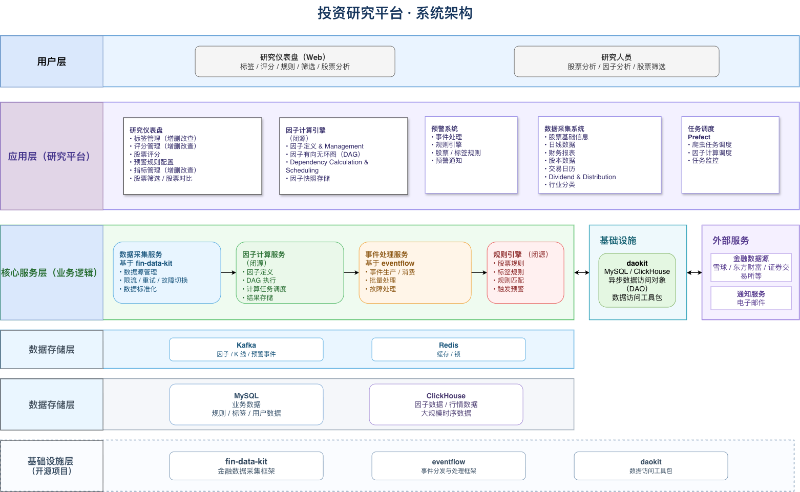
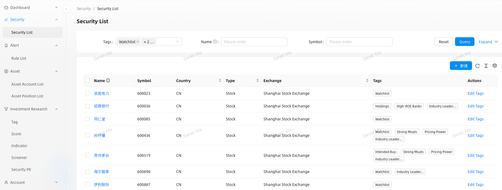
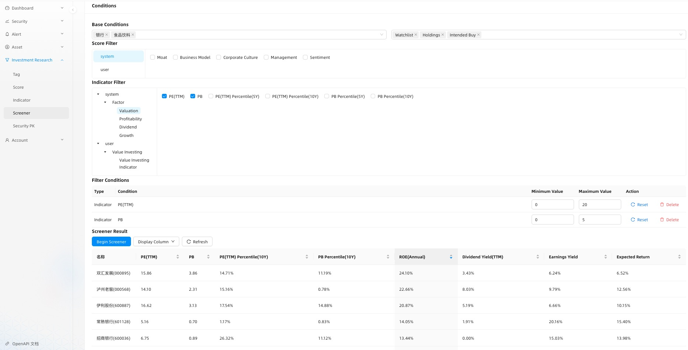
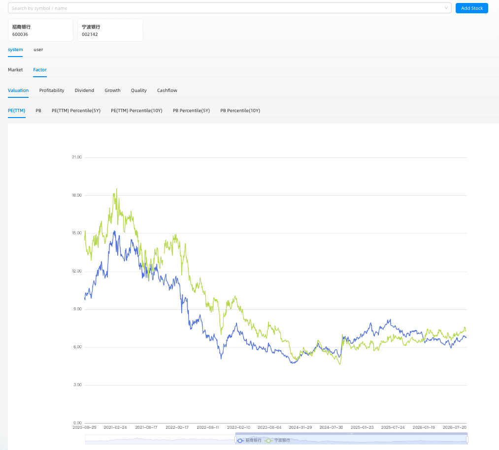
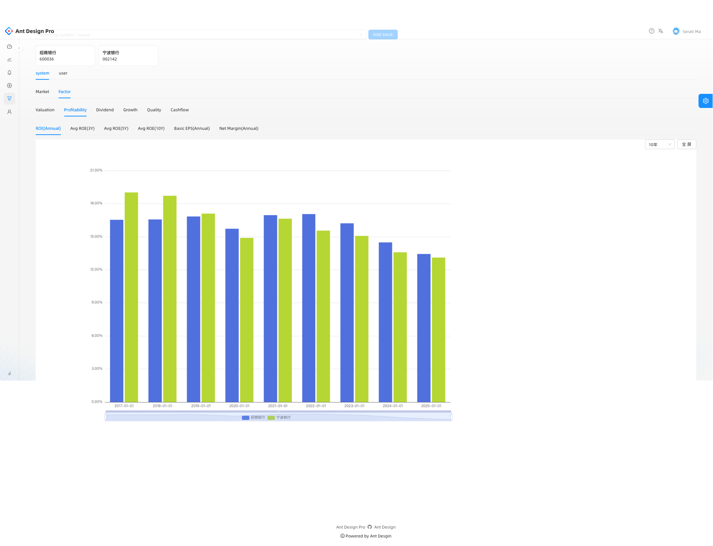
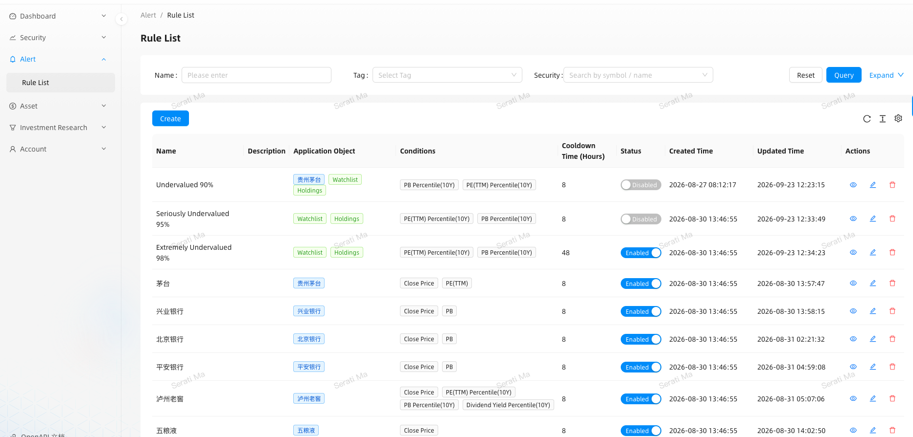
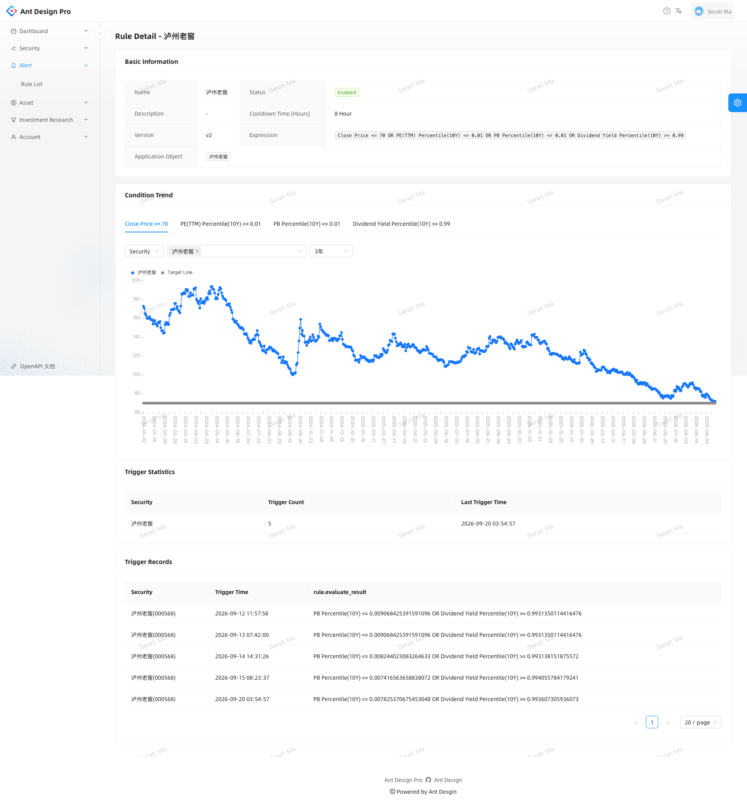

# investment-platform

一个面向基本面分析与价值投资的个人投资研究平台。

平台整合了以下核心能力：

- **金融数据**：从多个数据源采集行情数据与基本面数据。
- **因子引擎**：基于 DAG（有向无环图）的基本面与估值因子计算引擎，支持分布式并行执行。
- **自定义研究指标**：支持用户自定义指标，并将其应用于股票筛选、个股对比和预警。
- **事件与预警系统**：基于 Kafka 的事件处理系统，通过分区与并行消费实现投资规则评估。
- **研究工作台**：提供股票筛选、评分、对比及投资研究工作流。

## 系统架构概览


```
          金融数据源
              │ 
              ▼ 
┌─────────────────────────────┐ 
│          数据采集             │ ← fin-data-kit 
└─────────────┬───────────────┘            
              ▼ 
┌─────────────────────────────┐ 
│     MySQL / ClickHouse      │
└─────────────┬───────────────┘ 
              ▼ 
┌─────────────────────────────┐ 
│          因子引擎            │ 
│        依赖关系 DAG          │ 
│        分布式并行任务         │ 
└─────────────────────────────┘ 
              │ Kafka 
              ▼ 
┌─────────────────────────────┐ 
│          事件处理            │ 
│      消费组 / 并行消费        │ ← eventflow 
│        事件与规则处理         │ 
└────────────┬────────────────┘
             ▼ 
┌─────────────────────────────┐ 
│         研究工作台           │
│          股票选股            │
│          股票评分            │
│          股票对比            │
│          投资预警            │
└─────────────────────────────┘
```

**本项目为私人项目，核心应用程序不开源。** 从平台中提取的通用基础设施已作为独立开源项目发布。

**开源基础设施项目**

- [daokit](https://github.com/lanlingshao/daokit)
- [fin-data-kit](https://github.com/lanlingshao/fin-data-kit)
- [eventflow](https://github.com/lanlingshao/eventflow)

---

## 系统架构

该平台分为几个主要子系统：



系统架构将通用基础设施与投资领域的业务逻辑分离，降低模块之间的耦合。

## 核心组件

### 1. 金融数据采集

数据采集子系统基于 [fin-data-kit](https://github.com/lanlingshao/fin-data-kit) 构建。

系统从多个数据源采集并标准化金融数据，包括：

- 日线行情数据
- 财务报表数据
- 股本数据
- 股票列表与证券基础信息
- 交易日历
- 其他基本面与市场数据

应用层声明所需的数据能力，而不是直接依赖某个特定的数据提供商。

例如：

```text
应用层
   │
   │ 请求：daily_kline
   │
   ▼ fin-data-kit
   │
   ├── 主数据源
   │
   ├── 备用数据源
   │
   ├── 限流控制
   │
   └── 自动重试
   │
   ▼
金融数据
```

这种设计允许系统在不与特定数据提供商产生强耦合的情况下，更换或扩展数据源。

**主要特性**

- 多数据源支持
- 基于数据能力的数据访问方式
- 可配置的数据源优先级
- 请求限流
- 自动重试
- 数据源故障切换
- 统一的数据访问接口
- 异步数据采集

### 2. 因子计算引擎

因子引擎是平台的核心量化研究组件。

它负责计算基本面与估值指标，例如：

- 市盈率（PE）
- 市净率（PB）
- 净资产收益率（ROE）
- 股息率
- 盈利能力相关指标
- 历史估值分位数
- 其他衍生投资因子

引擎使用基于 DAG（有向无环图）的依赖模型描述不同因子之间的计算关系。

例如：

```text
财务报表
    │
    ├───────────────┐
    ▼               ▼
  净利润           股东权益
    │               │
    └───────┬───────┘
            ▼ ROE
            │
            ▼
      历史 ROE 分析


市场数据 ──────────────┐
                      ▼
                  估值因子
                      │
          ┌───────────┴───────────┐
          ▼                       ▼
         PE                      PB
          │                       │
          └───────────┬───────────┘
                      ▼
                  估值分位数
```

DAG 能够确保依赖因子按照正确的顺序计算，并避免不必要的重复计算。

**分布式与并行执行**

- 显式描述因子之间的依赖关系，确保前置因子完成后再执行依赖它们的计算任务。
- 当任务依赖条件满足时，允许相互独立的因子任务并发执行。
- 支持按因子、证券或时间范围拆分适合并行处理的工作负载，使历史数据计算与增量更新能够利用多个 Worker 并行执行。
- 将任务编排与因子计算逻辑分离，使系统能够随着数据规模增长灵活扩展执行能力。

实际并行度取决于任务粒度、依赖约束、Worker 容量及存储层的处理能力。

### 3. 事件与预警系统

预警子系统连接数据管道、因子引擎与投资规则。

系统使用 Kafka 作为事件传输层，通过 Topic 分区和 Consumer Group 实现并行事件处理。具体并行能力受到 Kafka 分区数量和消息顺序约束。

**分布式与并行事件处理**

- 利用 Kafka 分区和消费组，将事件消费任务分配给多个 Worker。
- 支持独立事件或不同分区并发处理。在分区数量及工作负载允许的情况下，可通过增加消费者提高处理能力。
- 将事件传输、批量消费、故障处理与具体的投资规则评估逻辑分离。
- 支持在事件到达时，根据股票、标签和指标条件执行规则评估。

Kafka 仅保证同一分区内的消息顺序。对于可能发生的重试与重复投递，消费者及事件处理器应具备相应的处理能力。

**事件处理流程**

```text
数据采集
    │
    │ Kafka 事件
    ▼
┌───────────────┐
│   事件系统     │
└───────┬───────┘
        │
        ▼
┌───────────────┐
│   规则引擎     │
└───────┬───────┘
        │
        ├── 股票规则
        │
        ├── 标签规则
        │
        └── 指标条件
        │
        ▼
       预警
```

事件处理层基于开源框架 [eventflow](https://github.com/lanlingshao/eventflow) 构建。

具体的投资规则引擎由应用层实现，负责根据接收到的事件评估投资条件。

典型场景包括：

- 估值阈值预警
- 因子阈值预警
- 指标趋势条件预警
- 个股专属规则
- 基于标签的规则

通过将事件传输基础设施与投资规则分离，事件处理框架可以保持通用性，而投资业务逻辑则留在核心应用中。

### 4. 投资研究工作台

研究工作台是用户与投资研究系统交互的主要入口。

#### 4.1 研究标签

系统支持使用面向投资研究的标签对股票进行分类。

例如：

- 行业龙头
- 具有较强竞争优势的企业
- 具有定价权的企业
- 高 ROE 企业
- 自选观察列表
- 持仓股票
- 计划买入列表

研究标签还可以作为股票筛选和预警规则的输入条件。

---

#### 4.2 股票评分

平台支持股票评分与研究指标管理。

评分系统允许将定性投资研究与定量指标相结合。

例如：

```text
公司
  │
  ├── 财务指标
  │
  ├── 估值指标
  │
  ├── 研究标签
  │
  └── 人工评分
          │
          ▼
      投资观点
```

---

#### 4.3 自定义研究指标

指标系统同时支持系统内置指标与用户自定义研究指标。

系统指标由因子引擎生成；用户自定义指标则可以基于已有数据和数学表达式构建。

```text
                  研究指标
                     │
          ┌──────────┼──────────┐
          ▼          ▼          ▼
       股票筛选     股票对比     预警规则
```

例如：

```text
财务指标
    +
估值指标
    +
用户自定义表达式
    │
    ▼
自定义研究指标
    │
    ├── 股票筛选
    ├── 股票对比
    └── 预警规则
```

该设计允许将投资思路转化为可计算、可复用的研究指标，而不是仅仅停留在人工观察层面。

同一个指标可以在不同的研究工作流中重复使用，包括股票筛选、个股对比和持续预警监控。

---

#### 4.4 股票筛选器

股票筛选器支持组合使用以下条件过滤股票：

- 行业
- 研究标签
- 股票评分
- 估值指标
- 财务指标
- 用户自定义指标

例如：

```text
行业符合条件
    AND
ROE > 指定阈值
    AND
PB < 指定阈值
    AND
PE 历史分位数 < 指定阈值
    AND
股息率 > 指定阈值
```

其核心目标是将投资思路转化为明确、可重复执行的筛选条件。

---

#### 4.5 股票对比

平台提供股票对比界面，支持从多个维度比较不同公司。

典型的对比维度包括：

- 估值水平
- 盈利能力
- 成长能力
- 股息与分红
- 财务质量
- 历史指标

该功能旨在辅助横向比较和投资研究，而不是取代基本面分析本身。

---

#### 4.6 预警管理

预警界面支持配置和监控投资规则。

规则可以引用以下对象或条件：

- 股票
- 标签
- 指标
- 指标趋势
- 估值条件

系统通过数据管道和因子计算管道生成的事件，对这些规则进行持续评估。

---

## 任务调度

数据采集与因子计算任务通过 [Prefect](https://www.prefect.io/) 进行编排和调度。

典型工作流如下：

```text
交易日历
    │
    ▼
数据采集
    │
    ▼
金融数据更新
    │
    ▼
因子计算
    │
    ▼
因子快照
    │
    ▼
事件处理 / 预警
```

调度层负责：

- 周期性数据采集
- 因子计算
- 任务依赖管理
- 失败重试
- 工作流执行
- 历史数据回填
- 定时执行与手动触发

通过这种设计，工作流编排与各服务内部的业务逻辑相互分离。

---

## 开源基础设施

平台从核心应用中提取了多个可复用的基础设施组件，并将它们独立开发为开源项目。

### daokit

**面向 MySQL 与 ClickHouse 的异步数据访问工具包**

`daokit` 是一个基于 SQLAlchemy、asyncmy、asynch 和 clickhouse-connect 构建的异步数据访问工具包。

它提供可复用的 DAO 基类与数据库客户端，同时将应用特有的查询规则保留在精简、明确的 DAO 子类中。

项目地址：

[https://github.com/lanlingshao/daokit](https://github.com/lanlingshao/daokit)

---

### fin-data-kit

**异步金融数据采集框架**

`fin-data-kit` 是一个用于采集金融数据的异步框架。

调用方只需声明所需的数据能力，框架负责处理：

- 数据源选择
- 数据源优先级
- 请求限流
- 失败重试
- 数据源故障切换
- 异步执行

项目地址：

[https://github.com/lanlingshao/fin-data-kit](https://github.com/lanlingshao/fin-data-kit)

---

### eventflow

**基于 Python 与 Kafka 的异步事件分发框架**

`eventflow` 将以下职责分离：

- 事件生产
- 消息代理消费
- 批量处理
- 异常与失败处理

借助这种设计，应用可以专注于实现业务事件处理器，而不必在各处重复嵌入 Kafka 相关的基础设施代码。

项目地址：

[https://github.com/lanlingshao/eventflow](https://github.com/lanlingshao/eventflow)

---

## 系统截图

### 投资研究工作台



---

### 股票筛选



---

### 股票对比





---

### 预警规则





## 工程设计亮点

### 金融数据基础设施

设计并实现多数据源异步金融数据采集层，支持数据源选择、请求限流、失败重试与故障切换机制。

### 因子依赖管理与分布式并行计算

构建基于 DAG 的因子计算引擎，对财务与估值指标之间的依赖关系进行建模，确保前置因子按正确顺序计算，避免不必要的重复计算，并支持独立任务及可拆分工作负载在多个 Worker 之间并行执行。

### 分布式事件处理

通过异步 Kafka 事件管道连接数据采集与因子计算模块。基于分区的消费机制和消费组 Worker 支持符合条件的事件并发处理，同时将通用事件处理基础设施与投资专属规则逻辑分离。

### 面向投资研究的领域建模

将以下投资研究概念建模为明确的领域对象：

- 标签
- 评分
- 指标
- 筛选条件
- 预警规则
- 股票对比

避免将这些业务概念直接耦合到 UI 逻辑中。

### 可扩展的执行能力与工作负载编排

围绕可拆分的任务设计计算与事件处理流程：因子 DAG 负责协调依赖关系，同时允许独立任务并发执行；Kafka 分区支持多个消费者并行处理事件；Prefect 则负责编排数据采集、因子计算、历史数据回填和定时研究工作流。

### 工作流编排

使用 Prefect 编排数据采集、因子计算、历史数据回填及定时研究工作流。

### 基础设施与投资业务逻辑分离

将可复用的基础设施提取为独立开源项目，而投资专属的因子逻辑、规则逻辑和研究工作流则保留在私人应用中。

## 技术栈

| 层级 | 技术 |
|---|---|
| 编程语言 | Python |
| API 框架 | FastAPI |
| 关系型数据库 | MySQL |
| 分析型数据库 | ClickHouse |
| 缓存 | Redis |
| 消息中间件 | Kafka |
| 事件处理 | eventflow |
| 数据访问 | SQLAlchemy / asyncmy / clickhouse-connect / daokit |
| 数据采集 | fin-data-kit |
| 工作流编排 | Prefect |
| 前端 | React / Ant Design |
| 反向代理 | Nginx |

---

## 项目结构

个人应用按照以下主要业务领域组织：

```text
investment-platform/
│
├── data/
│   └── 金融数据采集
│
├── factor/
│   └── 因子计算引擎
│
├── event/
│   └── 事件处理与预警
│
├── rule/
│   └── 投资规则引擎
│
├── research/
│   └── 投资研究领域服务
│
├── admin/
│   └── 投资研究工作台
│
└── workflow/
    └── Prefect 工作流
```

核心应用的具体实现代码不会在本仓库中公开。

---

## 项目状态

该平台是一个持续迭代的个人投资研究系统。

目前已实现的主要功能包括：

- 多数据源金融数据采集
- 金融数据存储
- 基本面与估值因子计算
- 支持分布式并行执行的因子依赖 DAG
- 基于 Kafka 的事件处理与分区并行消费
- 基于股票和标签的预警规则
- 投资研究标签
- 股票评分
- 自定义研究指标
- 股票筛选
- 股票对比
- 定时与手动触发的工作流

随着新的研究需求出现，系统将持续演进。

---

## 未来规划

平台将根据不断出现的研究需求持续迭代。

计划扩展的方向包括：

- **公司研究**：结构化公司研究、竞争优势、护城河、管理层及其他定性研究维度。
- **行业研究**：行业结构、行业趋势、竞争格局及产业层面的分析。
- **财报研究**：进一步深化财务报表分析与财报解读能力。
- **AI 辅助研究**：利用 AI 提升金融数据解读、公司研究、研究报告分析及投资研究工作流的效率。

长期目标是将**结构化金融数据、量化指标、定性研究与 AI 辅助工作流**整合为统一的投资研究系统。

---

## 开源理念

平台本身是一个面向特定投资研究领域的业务应用，同时将多个通用基础设施组件提取为独立的开源库。

这种分离方式使可复用的工程组件能够独立演进，而不受投资业务逻辑变化的直接影响。

开源项目：

- [daokit](https://github.com/lanlingshao/daokit)
- [fin-data-kit](https://github.com/lanlingshao/fin-data-kit)
- [eventflow](https://github.com/lanlingshao/eventflow)

个人应用展示了如何将这些基础设施组件组合起来，构建一个完整的金融投资研究系统。